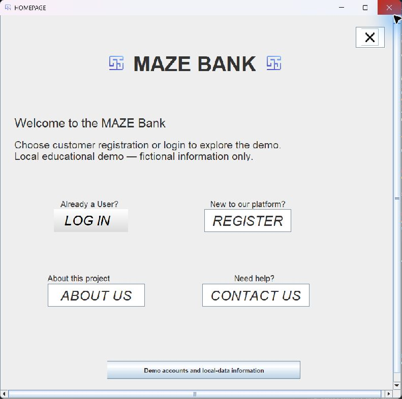
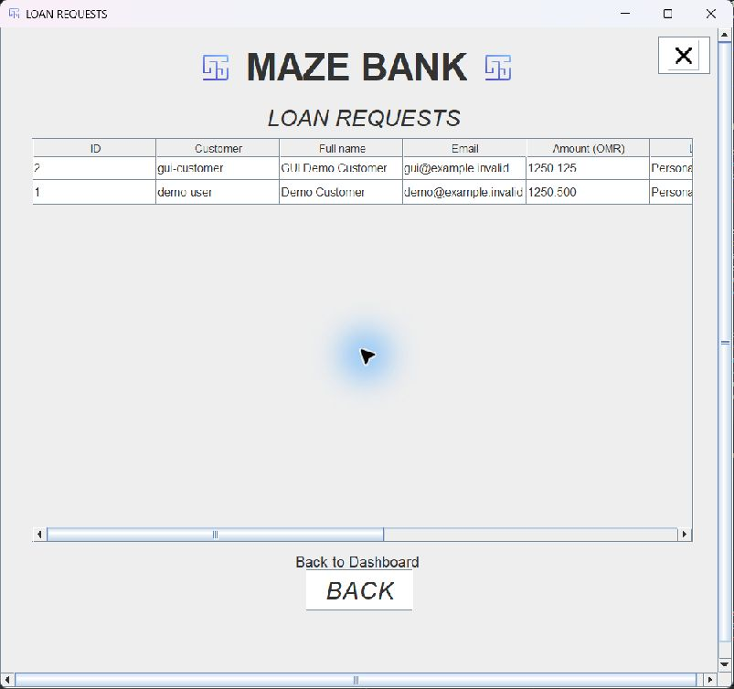

# Maze Bank — original coursework and Prepare preview

Two editions in one repository:

| Edition | Purpose | Experience it |
|---|---|---|
| **Prepare — new research preview** | Organise claims, household costs, documents and questions before a first German debt-counselling appointment. | [Open browser preview](https://ahmad-527.github.io/maze-bank-loan-system/) · [Run locally](flagship/README.md) |
| **Original Java restoration** | Educational loan-application/customer-query simulation from undergraduate coursework. | [Download original Java demo](https://github.com/ahmad-527/maze-bank-loan-system/releases/tag/v1.0.0-preview) |

Prepare has editable uncertainty/dispute and repeated-record handling, explained monthly conversions, encrypted local saves/backups and a reviewed HTML handover. **It is a working research preview using fictional data, not a validated flagship or banking/advice service.** The 100-paper product review is documented; twenty comparator desk profiles do not yet meet the full hands-on benchmark requirement, and human/adviser validation remains open. [Research and validation dossier](docs/prepare/README.md).

The original Java source/resources and `coursework-source` archive remain preserved. The later Prepare research, design and implementation were produced with Codex assistance.

## Original Java coursework restoration


An undergraduate Object Oriented Programming project, restored as a runnable desktop portfolio demo. Customers register, sign in and submit fictional loan applications and questions. Administrators review saved submissions in a separate dashboard.

**Local educational simulation. Use fictional information only.** The application does not connect to a bank, move money, calculate lending eligibility or approve loans.



## Run the demo

1. Install a Java **17 or newer** desktop runtime if needed, for example [Eclipse Temurin](https://adoptium.net/temurin/releases/?version=17).
2. Download and extract the application ZIP from [Releases](https://github.com/ahmad-527/maze-bank-loan-system/releases).
3. On Windows, double-click `Run.cmd`. On macOS/Linux, run `sh Run.sh` in a desktop session. Alternatively: `java -jar maze-bank-demo-1.0.0-preview.jar`.

Windows desktop execution was checked. macOS/Linux launch scripts are provided but have not been tested on those operating systems. A graphical desktop is required for this Java edition; the separate Prepare browser preview is linked above.

| Login screen | User ID | Password |
|---|---|---|
| Customer | `demo-user` | `DemoUser!2026` |
| Admin | `demo-admin` | `DemoAdmin!2026` |

These are deliberately public, fictional walkthrough accounts created on the first database initialisation. Use **LOG IN → USER / ADMIN** on the home screen. No account, API key or Oracle installation is required.

## What to try

- Sign in as `demo-user`; inspect the seeded fictional application and question.
- Register another customer using a made-up mobile number and a reference such as `DEMO-1234`; submit a loan application and query.
- Review **My applications** and **Customer queries**: a customer sees only their own records.
- Sign out, then use the admin login to review submissions from all customers. Only a signed-in demo administrator can create another demo administrator.
- Close and reopen the app; committed records remain in the local database.

Loan types, terms and the amount ceiling are demonstration input rules, not financial offers. Amounts use OMR with up to three decimal places, retaining the coursework's currency convention. There is no approval/rejection, repayment, balance, payment or email-sending feature.



## Original source and restoration

- [`main`](https://github.com/ahmad-527/maze-bank-loan-system/tree/main): runnable restoration using Java 17, Swing, JDBC and embedded H2.
- [`coursework-source`](https://github.com/ahmad-527/maze-bank-loan-system/tree/coursework-source): two selected Oracle-oriented source variants, with database connection literals and private contact/identifier details replaced by explicit placeholders. This archive is for inspection and is **not** the runnable download.

The original used Oracle, contained inconsistent table/column definitions and coupled SQL to UI actions. The restoration supplies the missing persistence model, parameterised SQL, salted password hashes, role boundaries, record ownership, persisted query retrieval, corrected navigation and usable labels. It retains the principal coursework screens. It is a maintenance/restoration exercise, not a claim that those later repairs were part of the historical submission. See [source and restoration notes](docs/SOURCE_AND_RESTORATION.md).

## Data and boundaries

H2 stores records in `~/.maze-bank-demo/maze-bank.mv.db` on the local computer. Set `MAZEBANK_DATA_DIR` to an unused folder before launching to keep a separate demo dataset. Paths containing semicolons or newlines are rejected. Close the app before backing up the folder; use one app instance per folder.

Passwords use PBKDF2-HMAC-SHA256 with individual random salts and 600,000 iterations. That does **not** make this a production banking system: the local database is unencrypted, has no external authentication boundary, and public demo administrators can inspect its fictional records. There is no independent security audit, rate limiting, recovery workflow or regulated deployment review. Do not enter real banking, identity, contact or password information.

## Build and validation

Requires JDK 17+ and Maven 3.9+:

```sh
mvn --batch-mode --strict-checksums clean verify
java -jar target/maze-bank-demo-1.0.0-preview.jar
```

The shaded JAR contains its H2 dependency; Maven caches, database files and build outputs are excluded from source control. [Validation notes](docs/VALIDATION.md) distinguish automated service tests from desktop checks and untested environments.

## Attribution and dependency notices

Portfolio project: **Ahmad Sajjad Siddiqui**. Module: **CC17-2 Object Oriented Programming**. Historical source is preserved separately from the later runnable restoration. Submission reports and student identifiers are not distributed here.

H2 2.5.252 is redistributed unmodified under its own terms; see [third-party notices](THIRD_PARTY_NOTICES.txt) and [full H2 licence](licenses/H2-LICENSE.html). No blanket licence is granted for the coursework or bundled image resources by this repository.
